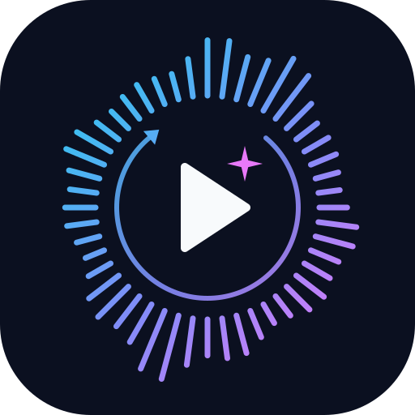

<p align="center"></p>

# streaming_media

Human interacts with AI using streaming audio and video. This project will develop and maintain an audio/video streaming library that targets human-AI experience on various platforms, devices and links.

streaming_media is a real-time audio/video streaming library, from servers and browsers to phones and embedded devices, designed to keep calls working over unstable links. It is developed by a program in which agents improve it continuously.

## The program

The library evolves through a loop that [program.md](agents/program.md) defines, run by three AI agents with GitHub as the shared record:

```
 Tester ──files issues──> Fixer ──opens PRs──> CI + Reviewer ──approve──> main
   ^                                                                       │
   └──────────────── next run tests the improved main ─────────────────────┘
```

- **Tester** runs scripted calls in the [test bench](testbench/README.md) over emulated bad links (loss, jitter, outages, bandwidth drops, queues, cross traffic) and measures what users would notice: audio gaps, video freezes, delay and recovery time. It also runs the same scenarios through libwebrtc to find where this library falls short of it. Each problem it finds is filed as an issue that reproduces it in one command.
- **Fixer** turns each issue into a failing test, fixes the root cause and opens a PR. It also builds the `roadmap` features the Owner files.
- **Reviewer**, a separate GitHub App identity, checks every PR for correctness, tests, regressions against the [baseline](testbench/baseline/) and "gaming" (loosened thresholds). A PR merges automatically once it has the Reviewer's approval and every platform in CI is green.
- **Owner** (a person) sets direction through `agents/program.md` and `roadmap` issues, and decides anything an agent labels `needs-human`.

Progress is measured, not asserted: a change has to improve the user-experience metrics or leave them unchanged, and every problem found becomes a scenario that keeps it fixed. The goals, labels, quality gates and guardrails are in [program.md](agents/program.md), and the agents' instructions are in [agents/](agents/).

## Scope

The library grows in two stages, both measured on the same test bench ([program.md section 0.1](agents/program.md#01-scope-and-stages)):

1. **Baseline: what WebRTC handles** (current stage). These are the problems in sections 1-10 of [Problems WebRTC solves](docs/02-webrtc-problems-solved.md): connectivity, security, packet loss, jitter and timing, congestion control, audio, video, synchronization, data channels and observability. The bar is parity with libwebrtc's current mechanisms, not older or simpler variants. Parity is measured by running every test bench scenario through both libraries over the same emulated links ([comparison](docs/results/compare-webrtc.md)). Each gap is an issue labelled `stage:baseline`.
2. **Human-AI streaming.** Features for problems that arise because the other side of the call is an AI, added one at a time on top of the baseline without regressing it. Examples are a two-way conversation test bench, metrics for response delay, barge-in and how cleanly the user's speech reaches the AI, and AI media sent in faster-than-real-time bursts and cancelled on barge-in. These issues are labelled `stage:ai`.

Baseline work comes before AI work. **Sections 1, 2, 9 and 10** (connectivity, security, data channels and observability) are ported from libwebrtc too ([#944](https://github.com/aray4702/streaming_media/issues/944)), so the library doesn't leave them to a host stack. The Owner chose standard WebRTC on the wire for both topologies: the AI server (client-server) and P2P calls on web, Android and iOS, with 1:1 calls peer-to-peer; group calls of up to 6 go through an SFU, LiveKit (#1160; the small-group mesh is dropped). What is ported and how it differs: [libwebrtc parity, section 10](docs/design/libwebrtc-parity.md).

## The library

The library implements, in portable C++20, sections 1-10 of [Problems WebRTC solves](docs/02-webrtc-problems-solved.md): the resilience algorithms and the connection around them. `docs/algorithms/` has 74 algorithm documents in sections 1-10: connectivity (STUN, ICE, TURN, SDP, the endpoint), security (TLS/DTLS, SRTP), packet loss, jitter and timing, congestion control, audio processing, video adaptation, synchronization, the RTP/RTCP session layer, data channels and observability. Each one has unit tests, an end-to-end test over a simulated network where it has one, at least one benchmark (139 in all: speed budgets, and quality gates where an outcome can be gated), metrics and structured events, and a design and results document.

Sections 3-8 have no dependencies. Connectivity (section 1) and security (section 2) need two libraries, both fetched by CMake at configure time (see `cmake/`): a TLS library behind one interface, BoringSSL (default) or mbedTLS 3.6, chosen with `SM_TLS_BACKEND`, and libsrtp 2.8.0. Build with `-DSM_WITH_TLS=OFF` to leave both out. Data channels (sections 9.6-9.9) are optional and off by default: `SM_WITH_DATACHANNEL` switches them on and off, and they also need the TLS library. The observability outputs (section 10) have build switches too.

## Documents

Background research:

1. [Existing libraries](docs/01-library-survey.md): WebRTC stacks, SIP/RTP stacks, loss-tolerant transports, codecs and media frameworks, with a recommended starting point.
2. [Problems WebRTC solves](docs/02-webrtc-problems-solved.md): every problem area mapped to the mechanism that handles it, plus what WebRTC leaves to the application. All ten sections are implemented here.
3. [WebRTC footprint](docs/03-webrtc-footprint.md): binary and RAM size of libwebrtc and lighter alternatives.
4. [Call data flow](docs/04-webrtc-call-data-flow.md): how media moves through a one-on-one call, from setup through send, receive and the feedback loop.
5. [Streaming options](docs/05-streaming-options.md): passthrough, bitrate ladder, live re-encode and simulcast/SVC for streaming a video file, and when each one fits.

The library:

- [Program](agents/program.md): vision, goals, agent roles, quality gates and guardrails of the self-evolution loop.
- [Test bench](testbench/README.md): a whole call through the library over a scripted unreliable link (loss, bursts, jitter, outages, capacity changes, bufferbloat, cross traffic), measured as user-experience metrics. The scenario suite and its baseline are the regression gate.
- [Fix records](docs/fixes/README.md): every problem found and fixed, with its root cause, fix, regression test and before/after results.
- [Browser port](web/): the library and test bench as a WebAssembly ES module with a JS API, plus a demo page.
- [Architecture](docs/design/architecture.md): layers, conventions, observability, and how the modules form a call.
- [Portability](docs/design/portability.md): platforms, presets, what was verified and how, performance across hardware, footprint.
- [Testing and benchmarking](docs/design/testing.md): test framework, network emulator, pass criteria, how to regenerate the results.
- [Algorithms](docs/algorithms/README.md): one document per algorithm, sections 1-10 (design, API skeleton, metrics, test methods, benchmarks, results, verification notes).
- [Verification results](docs/results/README.md): pass/fail and benchmark numbers per platform.
- [Comparison with libwebrtc](docs/results/compare-webrtc.md): every test bench scenario run through this library and a prebuilt libwebrtc over the same links ([how](compare/README.md)).
- [libwebrtc parity](docs/design/libwebrtc-parity.md): what is ported from libwebrtc M157 and how it differs, area by area; section 10 covers the connectivity, security and data channel ports.
- [Self-hosted TURN server](docs/deploy/turn-server.md): coturn on Amazon Lightsail, for tests on real networks and production.
- [Fuzz targets](fuzz/README.md): libFuzzer targets for the parsers that read network input.

## Status

| Section | Algorithms |
|---|---|
| 1. Connectivity | STUN, ICE agent with controller and ICE-lite, TURN over UDP, TCP and TLS, ICE-TCP host candidates (#1155), remote mDNS (`.local`) candidates resolved as libwebrtc does (#1156), SDP offer/answer and an endpoint that sets up ICE, DTLS-SRTP and RTP from SDP (#1062-#1064) (the mesh of 3-4 from #1072 is dropped for an SFU, #1160) |
| 2. Security | TLS and DTLS 1.2/1.3 on both backends (BoringSSL, mbedTLS), DTLS-SRTP, SRTP (libsrtp) |
| 3. Packet loss | NACK/RTX, XOR FEC, RED, PLC, keyframe requests (PLI/FIR/LNTF), NACK/FEC protection selection |
| 4. Jitter and timing | packet buffer, RTCP stats/RTT, delay manager, WSOLA time stretching, NetEq-lite audio jitter buffer, video jitter + render timing |
| 5. Congestion | transport-cc + REMB, GCC delay- and loss-based estimation, GCC controller, pacer, probing, bitrate allocator, frame dropper, resolution/CPU adaptation, outage handling |
| 6. Audio (APM) | echo canceller, echo delay estimation, noise suppression, AGC + limiter, high-pass filter, transient suppression, VAD, audio level (RFC 6464), resampler |
| 7. Video | freeze detection, HW->SW codec fallback, orientation (CVO), content hints + screen VFR, render scheduling, quality scaler |
| 8. Synchronization | RTP->NTP mapping, A/V lip sync with CNAME groups, absolute capture time / latency, header extensions + BUNDLE demux |
| 9. RTP session and data channels | RTCP engine (SR/RR, SDES, BYE, XR), RTP sender and receiver, the session facade, H.264 packetization (RFC 6184); data channels: dcSCTP over DTLS, DCEP and the data channel API, behind `SM_WITH_DATACHANNEL` (#1069, #1070) |
| 10. Observability | build and runtime switches (`SM_ENABLE_STATS`, `SM_ENABLE_METRICS`, `SM_ENABLE_EVENTS`, `SM_LOG_MIN_LEVEL`); ICE and DTLS connection stats (#1059) |
| Apple devices | Audio Units I/O and AVFoundation camera capture (`sm::device`, #1115), VideoToolbox H.264 (#1112); the library and its unit tests run on the iOS simulator in CI (#1107, #1108) |

**Apps** (on the library, deployed with the signaling service, the AI server and coturn on Amazon Lightsail):

| App | What it is |
|---|---|
| iOS app (SmCall, `apps/ios`) | SwiftUI calling app, verified on a real iPhone: calls the AI server or a web user by room code; GPU video at the received frame rate; iOS voice processing, as libwebrtc's iOS client; a Group mode with a grid of up to 6 through LiveKit |
| Web app (`apps/web`) | One page on the browser's WebRTC (Chrome), plus the signaling service (`apps/signaling`); a Group mode (`?group=1`) with a grid of up to 6 through LiveKit |
| AI server (`apps/ai_server`) | Answers `ai-` rooms with the library, a turn detector and a reply source; caller-side results in [real-network calls](docs/results/real-network-calls.md); joins a LiveKit room as a participant (`--livekit`) |
| LiveKit SFU (Lightsail) | Group calls of up to 6: simulcast from each sender, the SFU picks a layer per receiver; receivers mix audio with libwebrtc's `AudioMixerImpl`. Real 6-way call: [real-group-call](docs/results/real-group-call.md) |


The native build passes 603 of 603 ctest tests on macOS arm64 (main with #1156, 2026-11-04; `interop.Coturn` skips without a local coturn), and the iOS simulator build passes its 238 unit tests (Xcode 27.2, the CI job's flags). The older full runs on WebAssembly (Node), ASan+UBSan and `-fno-exceptions -fno-rtti` cover sections 3-8 only ([details](docs/results/README.md)). Android and embedded Linux ARM are cross-built in CI.

**Stage 1 (parity with libwebrtc) has no open gaps** on main: see [Benchmarks](#benchmarks).

## Benchmarks

All numbers below come from the [test bench](testbench/README.md): a whole call through the library over a scripted emulated link, in simulated time, so a run is repeatable.

### Classic WebRTC features vs libwebrtc

The `compare-webrtc` CI job runs every one-way scenario through this library and through libwebrtc M157 over the same emulated links, 10 seeds each, and publishes the [parity report](https://raw.githubusercontent.com/aray4702/streaming_media/parity-data/parity.md) and the [side-by-side table](https://raw.githubusercontent.com/aray4702/streaming_media/parity-data/compare-webrtc.txt). On main 18404b4f (2026-11-04):

- **166 scenarios: 0 behind libwebrtc, 69 cells ahead of it.** A cell counts when the means differ by more than the parity band, which is the larger of the tie floor, 5% and one standard deviation of libwebrtc's seeds.
- **The 69 ahead cells** are in 21 scenarios. Two changes beyond libwebrtc account for them, each with a switch that restores libwebrtc's behaviour:
  - **#795:** when the link shows no sign of congestion, the sender drains its queue within 150 ms instead of holding up to 2 s, and after a feedback gap the encoder ramps back up instead of jumping (`uncongested_queue_time_limit`).
  - **#14:** a recovery probe brings the rate back after the link capacity returns, in about 1.3 s instead of about 15 s (`GccConfig::recovery_probing`).

  | Scenario | Audio mouth-to-ear p95 | Video end-to-end p95 | Other |
  |---|---|---|---|
  | 20% random loss (`issue_536_loss20_av_sync`) | 240 / 728 ms | 512 / 1,776 ms | A/V offset 355 / 1,173 ms |
  | 45 s feedback outage (`issue_536_reverse_outage_45s`) | 312 / 2,070 ms | 324 / 2,307 ms | A/V offset 147 / 1,595 ms |
  | Policed link (`issue_12_lossbwe_policer`) | 343 / 1,047 ms | 2,051 / 4,019 ms | A/V offset 1,887 / 3,445 ms |
  | Capacity drops and returns (`capacity_drop`) | 824 / 824 ms | 545 / 540 ms | settles in 1,340 / 14,630 ms; link use 82.8% / 54.8% |

  (this library / libwebrtc)
- **The other pairs:** of the 3,609 metric/scenario pairs, 3,456 tie within the tie floor. 110 lean towards this library and 43 towards libwebrtc, all inside the band. In the first comparison (2026-10-14), libwebrtc was better on 88 pairs and this library on 51.
- **Not compared:** `sm_compare` runs one-way calls, so it skips the 20 two-way (user and AI) scenarios and 7 that libwebrtc can't run the same way (the mesh scenarios were removed with the mesh, C16). The ICE comparison (`sm_ice_compare`) runs separately, including ICE-TCP and mDNS paths, and matches libwebrtc on every seed.

A sample of the table (mean of 10 seeds, this library / libwebrtc):

| Scenario | Audio concealed | Audio mouth-to-ear p95 | Video freezes (total) | Video end-to-end p95 | Link utilization | Queue p95 |
|---|---|---|---|---|---|---|
| clean_link: 2.5 Mbps, 25 ms one way | 0.3% / 0.3% | 245 / 245 ms | 0 / 0 ms | 137 / 137 ms | 88.6% / 88.6% | 75.8 / 75.8 ms |
| random_loss_5pct: 2 Mbps, 40 ms | 0.3% / 0.3% | 236 / 228 ms | 415 / 479 ms | 253 / 253 ms | 72.2% / 72.2% | 29.9 / 30.2 ms |
| burst_loss: 3% in bursts of ~6 | 1.4% / 1.4% | 299 / 288 ms | 413 / 419 ms | 284 / 276 ms | 75.9% / 76.1% | 46.0 / 46.6 ms |
| high_jitter: 40 ms jitter, reordering | 0.2% / 0.2% | 247 / 249 ms | 0 / 0 ms | 181 / 181 ms | 22.9% / 22.9% | 4.7 / 4.7 ms |
| capacity_drop: 2.5 Mbps to 500 kbps and back | 0.9% / 0.9% | 824 / 824 ms | 3,076 / 3,076 ms | 545 / 540 ms | 82.8% / 54.8% | 287 / 287 ms |
| bufferbloat: 1 Mbps, 2 s router buffer | 0.1% / 0.1% | 191 / 191 ms | 0 / 0 ms | 115 / 113 ms | 90.1% / 90.1% | 44.1 / 44.2 ms |
| cross_traffic: 1.5 Mbps flow joins a 3 Mbps link | 0.5% / 0.5% | 495 / 495 ms | 0 / 0 ms | 228 / 226 ms | 74.1% / 72.9% | 164 / 164 ms |
| issue_23_outage_3s: 3 s outage | 10.1% / 10.1% | 199 / 199 ms | 3,184 / 3,185 ms | 113 / 113 ms | 85.8% / 85.8% | 39.1 / 39.1 ms |
| audio_only_lossy: 10% loss with jitter | 0.5% / 0.5% | 155 / 152 ms | | | 77.0% / 77.1% | 4.1 / 3.6 ms |

### Human-AI conversation features

libwebrtc has no counterpart for these (stage 2: #2, #3, #4), so they are measured against the targets in [program.md section 6.3](agents/program.md) instead. The values are the test bench baseline on main (Linux x86_64, the CI `testbench` job). Each call is two-way audio on a 100 ms RTT link with three scripted user turns:

- **Response delay** is what the transport adds between the end of the user's turn and the first AI sample heard, not counting the AI's own time (thinking, the 600 ms its endpointer waits, and generating the first chunk). Target: p95 under 500 ms.
- **User speech lost** is the share of the user's speech that the AI side concealed or never played. Target: at most 2%.
- **Barge-in stop** is the time from the user starting to talk over the AI to the AI's voice stopping at the user's ear. The user's device mutes the AI locally as soon as it hears its user, then the AI cancels the rest of its reply.

| Scenario | Response delay p50 / p95 | User speech lost | Barge-in stop | Turn-detection errors |
|---|---|---|---|---|
| conversation_clean | 290 / 308 ms | 0% | | 0 |
| conversation_loss_5pct | 320 / 338 ms | 0.37% | | 0 |
| conversation_jitter_50ms | 380 / 416 ms | 0.22% | | 0 |
| conversation_burst_loss (5% in bursts) | 310 / 310 ms | 5.7% | | 0 |
| conversation_barge_in | 270 / 306 ms | 0% | 190 ms | 0 |
| conversation_barge_in_capacity_drop | 360 / 360 ms | 0.96% | 210 ms | 0 |
| conversation_outage_user_turn (2 s outage in the user's turn) | 270 / 306 ms | 22% | 3,390 ms | 2 |

AI-generated media (#4): the AI side's source produces speech at 3x real time in 1 s bursts, and the library sends it at real time or, with `ai_send_ahead`, slightly early so the user's jitter buffer holds a cushion.

| Scenario | Response delay p50 / p95 | Source ahead of real time | Underruns | User speech lost | Barge-in |
|---|---|---|---|---|---|
| ai_source_clean | 280 / 298 ms | up to 2.1 s | 0 | 0% | |
| ai_source_loss_5pct | 320 / 329 ms | up to 2.1 s | 0 | 0% | |
| ai_source_capacity_drop | 305 / 307 ms | up to 2.1 s | 0 | 0% | |
| ai_source_adaptive_loss_5pct (adaptive send-ahead) | 450 / 470 ms | up to 1.9 s | 0 | 0.27% | |
| ai_source_barge_in | 260 / 314 ms | up to 1.8 s | 0 | 0% | stopped in 210 ms; 5.7 s of queued reply dropped; 0 ms of AI audio heard after the stop |

Two scenarios are outside the conditions the targets cover (up to 5% random loss), and their numbers are expected:

- `conversation_burst_loss` (5% loss in bursts of about 5 packets each way) loses 5.7% of the user's speech on the baseline seed (3.05% mean over 20 seeds). The Owner decided the 2% target doesn't apply to it (#965). Audio NACK (`up_audio_nack on`, #971, off by default) brings it to a 1.1% mean, the option for native clients.
- `conversation_outage_user_turn` (the user-to-AI link down for 2 s in the middle of the user's turn) loses 22% of the user's speech, and the AI's turn detector sees a false end of turn and a false barge-in. Only the severity-1 target applies: the AI still hears the user and answers every turn.

### On real networks

- The library's TURN client against the self-hosted coturn on Amazon Lightsail (Oregon), from a home network: allocations, permissions, channel binds and relayed data both ways pass over UDP, TCP and TLS (`interop.Coturn`, #1054).
- Calls between the web app, the iOS app's controller and the AI server through the Lightsail signaling service and TURN relay, direct and relay-only, with the conversation metrics measured at the caller: [real-network calls](docs/results/real-network-calls.md) (#1121, #1124, #1126).
- **iOS app video** ([#1133](https://github.com/aray4702/streaming_media/issues/1133)): SmCall draws every received frame on the GPU (Metal, as libwebrtc's `RTCMTLVideoView`), at the received frame rate. In the simulator, from a 30 fps Chrome camera, it drew 95-100% of the decoded frames at 28-30 fps; before, a 10 Hz poll capped it at 10 fps. Verified on a real iPhone by the Owner.
- **Barge-in on iOS** ([#1124](https://github.com/aray4702/streaming_media/issues/1124)): SmCall uses iOS voice processing (VoiceProcessingIO's echo canceller and AGC, with the software AEC3 and AGC off), as libwebrtc's iOS client does; AEC3 stays the default elsewhere. In real calls through Lightsail, barge-ins stopped: iOS chain 8 of 8, our desktop chain (AEC3) 16 of 16, Chrome with its own audio processing 11 of 12. Early in a call, AEC3 catches the same barge-ins as libwebrtc's APM on the same audio (4 of 5 at 1 s into the first reply, 5 of 5 after its transparent mode turns on). Verified on a real iPhone by the Owner.

## Building

```sh
cmake --preset native            # or: cmake -S . -B build
cmake --build --preset native
ctest --preset native            # unit + e2e tests + benchmark gates
out/native/bench/sm_bench        # all benchmarks; --filter=audio/ --json=out.json
out/native/examples/simulated_call
out/native/testbench/sm_testbench testbench/scenarios/*.scn   # call scenarios
```

The `wasm` preset also builds `out/wasm/web/` (`sm_web.js`, `sm_web.wasm` and `index.html`). Serve that directory over HTTP to use the demo, or `import createSmModule from './sm_web.js'` in your own page or in Node.

Other presets: `native-asan`, `embedded` (size-optimized, no exceptions/RTTI, metrics and events compiled out), `wasm` (set `EMSCRIPTEN_ROOT`), `ios`, `ios-simulator`, `android-arm64`, `android-armv7` (set `ANDROID_NDK_HOME`), `linux-aarch64`, `linux-armv7`. Sections can be disabled with `-DSM_WITH_LOSS|TIMING|CC|AUDIO|VIDEO|SYNC|RTP=OFF`. `SM_WITH_RTP` (the RTP/RTCP session layer) needs loss, timing, cc, sync and video.

`tools/run_all.sh all` rebuilds every configuration, reruns everything and regenerates the algorithm and results documents.

## Using it

```cmake
find_package(streaming_media CONFIG REQUIRED)
target_link_libraries(app PRIVATE sm::sm)   # or sm::cc, sm::audio, ...
```

```cpp
#include "sm/cc/send_side_bwe.h"
#include "sm/timing/audio_jitter_buffer.h"

sm::cc::GccController gcc;                       // bandwidth estimation
auto update = gcc.Start(now);                    // target + pacing rate + probes
update = gcc.OnTransportFeedback(feedback, now); // on every transport-cc packet

sm::timing::AudioJitterBuffer jb;                // adaptive audio playout
jb.InsertPacket(rtp_timestamp, std::move(pcm), now);
jb.GetAudio(ten_ms_out, now);                    // every 10 ms from the audio device

sm::MetricsRegistry metrics;                     // observability
metrics.Register("send.gcc", &gcc);
metrics.Register("recv.neteq", &jb);
std::string prometheus = metrics.ToPrometheus();
```

Every API takes the current time as an argument and never reads a clock or starts a thread, so the application chooses the threading model, and the same code runs in real time on a device and in simulated time in tests. See [examples/simulated_call.cc](examples/simulated_call.cc) for a complete sender/receiver over an emulated unstable link.

## Layout

```
include/sm/{core,loss,timing,cc,audio,video,sync,sim}/   public headers
include/sm/{rtp,p2p,tls,pc,dcsctp}/                      session and connectivity headers
src/{core,loss,timing,cc,audio,video,sync,rtp}/          implementation
src/{p2p,tls,pc,dcsctp}/                                 connectivity, security, data channels
tests/{framework,unit,e2e}/                              tests and e2e simulations
tests/interop/                                           tests against real sockets and coturn
fuzz/                                                    libFuzzer targets for network parsers
bench/                                                   benchmarks
examples/                                                usage example
testbench/                                               call test bench, scenarios, baseline
web/                                                     WebAssembly bindings and demo page
agents/                                                  the program, the agents' instructions and their scripts (tools/)
tools/                                                   run_all.sh, gen_docs.py, catalog.py, testbench_compare.py
docs/                                                    research, design, algorithms, results
```

## Decisions

- **Wire formats:** everything the library sends must be standard RTP/RTCP that any WebRTC-compatible stack can parse: RTP with RFC 8285 header extensions and abs-capture-time, RTCP SR/RR, generic NACK, PLI, FIR, loss notification, transport-cc, REMB, RTX, RED, and ULPFEC over RED, with the standard payload formats for Opus (RFC 7587) and H.264 (RFC 6184, packetization mode 1). All of these are in place and checked against libwebrtc M157 in CI, except FEC, which still uses its own simple format ([#29](https://github.com/aray4702/streaming_media/issues/29)). H.264 is the only video format so far, and loss notification stays off for it, as in libwebrtc ([#47](https://github.com/aray4702/streaming_media/issues/47)). Connecting to a browser (ICE, DTLS-SRTP, SDP) is part of the library now ([#944](https://github.com/aray4702/streaming_media/issues/944)), also standard WebRTC on the wire, including SDP offer/answer (#1063, #1064).
- **Build and runtime switches:** `SM_WITH_TLS` and `SM_TLS_BACKEND` (`boringssl` or `mbedtls`) select the TLS library, `SM_WITH_DATACHANNEL` adds data channels, `SM_ENABLE_STATS`, `SM_ENABLE_METRICS` and `SM_ENABLE_EVENTS` compile the stats, metrics and event log in or out, and `SM_LOG_MIN_LEVEL` sets the lowest log level compiled in.
- **RTP/RTCP in the library:** the library provides the RTP/RTCP session layer (sender, receiver, the codecs' standard RTP payload formats, RTCP scheduling and feedback dispatch), so an app passes encoded frames and packet bytes instead of wiring the building blocks together. Done: the test bench runs every call through it ([#31](https://github.com/aray4702/streaming_media/issues/31) design, [#32](https://github.com/aray4702/streaming_media/issues/32) implementation).
- **Codecs:** the library contains no audio or video encoder or decoder. The app passes encoded Opus frames and H.264 access units in, and decodes audio through an `AudioDecoder` it supplies. The test bench uses a synthetic encoder: correctly framed H.264 that hits its target size, with no real picture or sound behind it.
- **Send-side adaptation in the library:** frame dropping, quality scaling and rate allocation are part of the library too, so the app only runs its encoder and decoder. Done so far ([#37](https://github.com/aray4702/streaming_media/issues/37)): `rtp::VideoSendController` runs the frame dropper, keyframe policy and pause per captured frame (the encoder loop is in [architecture.md](docs/design/architecture.md)); the quality scaler and resolution adaptation exist as building blocks but aren't wired in yet.
- **Call topology:** one-to-one calls are peer-to-peer. Group calls of up to 6 go through an SFU, LiveKit (the Owner's decision on [#1160](https://github.com/aray4702/streaming_media/issues/1160), 2026-11-04), with simulcast send and multi-stream receive in the library (C16-C21). The mesh of 3-4 (C9) is dropped. The SFU and multiparty pieces removed earlier ([#27](https://github.com/aray4702/streaming_media/issues/27)) stay out of the library: the SFU does layer selection and forwarding. BUNDLE demultiplexing stays, because WebRTC calls bundle.

## Next steps and open questions

**Where it stands (2026-11-05):**
- **Library:** it covers sections 1-10, plus simulcast send, multi-stream receive with renegotiation, and the receive-side audio mixer. Against libwebrtc M157 it is 0 behind and 69 ahead ([Benchmarks](#benchmarks)).
- **Apps:** the iOS app, the web app and the AI server run on real networks through the Lightsail host, for 1:1 calls and for group calls of up to 6 through LiveKit ([Status](#status)).
- **Requirements:** 104 of 105 are done (`tools/requirements.json`); only C13 (Android) is open.

**Done: group video calls of up to 6** ([#1160](https://github.com/aray4702/streaming_media/issues/1160), C16-C21, 2026-11-05): SFU topology (mesh dropped), simulcast send, multi-stream receive, LiveKit on Lightsail, web and iOS grids with the AI as a participant, a simulated SFU in the test bench and a real 6-way call.

**Later, for the Owner to choose:**

- **A real AI model** behind `AiReplySource` (speech in, speech out); its generation time adds directly to the response delay.
- **Protecting the Lightsail server's `/turn` endpoint:** a shared app key, credentials only inside a joined call, or user sign-in.
- **Android (C13)**, unplanned.
- **Group calls, follow-ups:** a real group call from well-connected clients (the 2026-11-04 run used one MacBook on home Wi-Fi, so it measured the link, not the SFU); the AI server subscribing to audio only, so LiveKit can pause video layers no one watches; per-participant freeze and jitter-buffer stats in the native client.

**Open questions:**

- **Target hardware:** MCU or embedded Linux, and how much RAM and CPU? The algorithms need an FPU; the packet-level sections could also run on Cortex-M4F/M7-class MCUs.
- **Which AI model and where it runs:** on the Lightsail host, on a GPU server, or as a hosted API. This decides the AI server's deployment and its share of the response delay.
- **Safari and Firefox** for the web app: when.

# License
Apache
